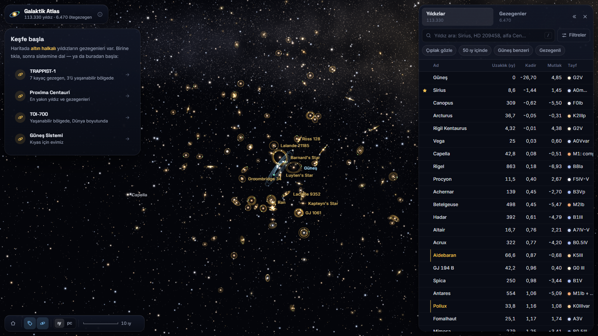
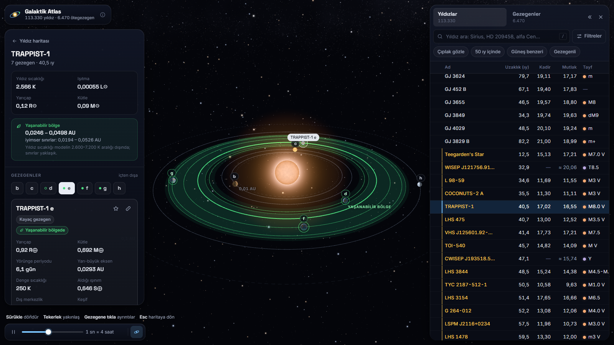
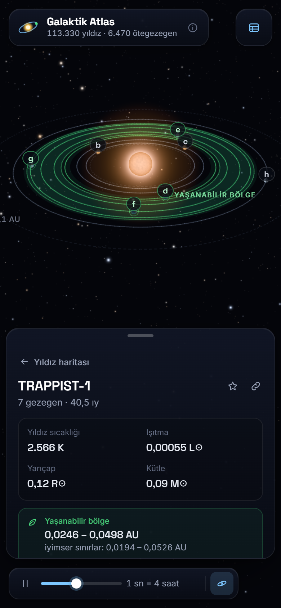

# Galaktik Atlas

**Gerçek yıldız kataloğunun içinde 3B uçun; ötegezegeni olan yıldızların sistemine dalın; 113 bin yıldızı ve 6 bin gezegeni arayın, filtreleyin, sıralayın.**



| Sistem görünümü | Telefon |
|---|---|
|  |  |

## Neler var

- **3B yıldız haritası** — HYG kataloğundan 109.404 yıldız gerçek konumlarıyla, tek çizim çağrısında. Parlaklık fizikseldir: her yıldız, kameranın bulunduğu noktadan görüneceği kadirle çizilir; yaklaştıkça parlar.
- **Ötegezegen sistemleri** — onaylı gezegeni olan 4.862 yıldız altın renkle işaretli. Yakındakiler haritada **minyatür sistem** olarak çizilir: gezegen başına bir yörünge (oranlar gerçek), üzerinde dönen gezegenler, yaşanabilir bölgedekiler yeşil. Yörünge düzleminin eğimi 3.694 sistemde NASA'nın ölçtüğü değerdir — geçiş (transit) yapan sistemler Güneş'ten bakınca kenardan görünür; Güneş Sistemi de tutulum düzlemindeki gerçek eğimiyle durur. Tıklayın, kamera uçsun; *Sisteme dal* ile tam sistem ve **yaşanabilir bölge** (HZ) açılır.
- **Veri tarayıcısı** — yıldızlar ve gezegenler için sanallaştırılmış tablo; anlık arama (`alfa centauri`, `HD 209458`, `trappist`…), çoklu filtre, her kolona göre sıralama. Filtreleme bir Web Worker'da çalışır.
- **İki yönlü bağ** — listede bir satıra tıklayın, kamera oraya uçar; haritada bir yıldıza tıklayın, liste o satıra kayar. Filtre açıkken haritada yalnızca eşleşen yıldızlar parlak kalır.
- **Güneş Sistemi ile karşılaştırma** — her sistem, logaritmik bir eksende bizimkiyle yan yana; gezegen boyutu Dünya ve Jüpiter'e göre.
- **Favoriler ve paylaşılabilir bağlantı** — seçim adres çubuğuna yazılır (`#star-32349`, `#system-trappist-1`, `#planet-proxima-cen-b`); favoriler tarayıcıda saklanır.
- Koyu, sakin bir arayüz; klavye erişimi, `prefers-reduced-motion` desteği, telefon düzeni.

## Çalıştırma

Node 20.19+ ya da 22.12+ gerekir (Node 24 ile geliştirildi).

```bash
npm install
npm run dev        # geliştirme sunucusu → http://localhost:5173
npm run build      # tip denetimi + üretim derlemesi (dist/)
npm run preview    # derlemeyi yerelde sun
```

Katalog verisi depoda hazır gelir (`public/data/`). Yeniden üretmek için:

```bash
npm run data            # önbellekteki kaynaklardan üret
npm run data:refresh    # HYG ve NASA'dan yeniden indir, sonra üret
```

Testler:

```bash
npm test           # 46 birim testi (HZ modeli, çapraz eşleme, filtre motoru, yörünge matematiği, üretilen veri)
npm run build && npm run e2e   # 22 uçtan uca kontrol; kurulu Chrome/Edge ile, başsız
```

| Kısayol | |
|---|---|
| `/` | Aramaya odaklan |
| `Esc` | Gezegen seçimini kaldır → sistemden çık → yıldız seçimini kaldır |
| `H` | Güneş'e dön |
| Çift tık | Gezegenli yıldızın sistemine dal |
| `↑` `↓` | Listede gezin (liste odaktayken), `Enter` ile sisteme dal |

## Mimari

```
┌──────────────────────────────────────────────────────────────────┐
│  VERİ HATTI — scripts/build-data (build-time)                     │
│  HYG CSV ─┐                                                       │
│           ├─► temizle ─► host ↔ HYG eşle ─► HZ ─► public/data/    │
│  NASA TAP ┘             (+ sentetik yıldız)      stars.bin (4,4 MB)│
│                                                  stars.meta.json  │
│                                                  systems.json     │
└──────────────────────────────┬───────────────────────────────────┘
                               ▼
┌──────────────────────────────────────────────────────────────────┐
│  UYGULAMA — React 19 + react-three-fiber                          │
│                                                                   │
│   3B sahne  ◄────────  zustand store  ────────►  Veri tarayıcısı  │
│   StarField            seçim · mod · filtre      TanStack Table   │
│   HostMarkers          sonuç satırları           + Virtual        │
│   SystemView                 ▲                        │           │
│   CameraRig                  │ Int32Array (satır no)  ▼           │
│   Picker · Overlay     filter.worker ◄──── filtre + sıralama isteği│
│                                                                   │
│   Detay paneli · favoriler (localStorage) · URL hash              │
└──────────────────────────────────────────────────────────────────┘
```

Çalışma zamanında uzak sunucuya istek atılmaz; üç veri dosyası uygulamayla aynı yerden gelir.

### Tasarım kararları

**Parlaklık modeli** (`src/three/view.ts`). Her yıldızın görünür kadiri kameraya göre hesaplanır: `m = M + 5·log10(d / d_ref)`, `d_ref = 10 pc`. Böylece kataloğun içindeyken o noktanın gerçek gökyüzünü görürsünüz. Kamera kataloğun dışına çıktığında `d_ref` büyür (pozlama artışı), bulut kararmaz. Aynı formül GPU'da (çizim) ve CPU'da (tıklama, etiket seçimi) çalışır; yani görebildiğiniz şey tıklayabildiğiniz şeydir.

**Seçim** (`src/three/Picker.tsx`). Ölçek 0,01 pc'den 8.000 pc'ye uzandığı için ışın–nokta kesişimi iş görmez. Adaylar ekran pikseline izdüşürülür: önce altın host işaretleri, sonra o an gerçekten görünen yıldızlar arasından imlece en yakın ve en parlak olan seçilir.

**Ölçek uçurumu** (`src/three/systemLayout.ts`). Işık yılı ile AU aynı sahnede duramaz; sistem görünümü kendi yerel ölçeğini kullanır. Uzaklıklar `√a` ile çizilir ve en dış yörünge kadraja sığacak şekilde normalize edilir. Arka plandaki yıldızlar, o yıldızın konumundan görünen gerçek gökyüzüdür.

**Filtre motoru** (`src/browser/filterEngine.ts`). Kolonlar tipli diziler (struct-of-arrays); sorgu bir Web Worker'da çalışır ve eşleşen satır numaralarını aktarılabilir bir `Int32Array` olarak döndürür. Tablo yalnızca ekrandaki ~30 satırı DOM'a koyar. Worker başlatılamazsa aynı motor ana iş parçacığında çalışır.

**Koordinat sistemi.** Veri dosyası HYG'nin ekvatoral Kartezyen koordinatlarını (J2000, parsek) saklar. Uygulama bunları yüklerken Galaktik çerçeveye döndürür: +X Galaksi merkezi, +Y kuzey Galaktik kutup. Samanyolu düzlemi sahnenin yatay düzlemidir.

### Dosya yapısı

```
scripts/build-data/   index.ts (orkestrasyon) · fetch_hyg.ts · fetch_exoplanets.ts
                      crossmatch.ts · habitable_zone.ts · stellar.ts · solar_system.ts · emit.ts
scripts/e2e/          check.mjs — uçtan uca tarayıcı kontrolleri
src/data/             schema.ts (veri sözleşmesi) · atlas.ts (çözme + türetme) · names.ts · labels.ts
src/store/            useAtlas.ts (zustand) · bootstrap.ts (yükleme, worker, URL hash)
src/three/            Scene · StarField · HostMarkers · MilkyWay · CameraRig · Picker · Overlay
                      SystemView · systemLayout.ts · view.ts
src/browser/          Browser · DataTable · Filters · columns · filterEngine.ts · filter.worker.ts
src/panels/           DetailPanel · CompareWidget · Hud · Chrome (üst çubuk, yükleme, hakkında)
src/lib/              astro.ts (koordinat, renk, Kepler) · format.ts · storage.ts
tests/                pipeline.test.ts · app.test.ts
```

## Veri hattı

`npm run data` şunları yapar (yaklaşık 1 saniye, kaynaklar önbellekteyse):

1. **HYG v4.1** CSV'sini okur (119.626 satır). Paralaksı ölçülememiş 10.222 yıldız (`dist = 100000`) gerçek bir 3B konuma sahip olmadığından haritaya alınmaz.
2. **NASA Exoplanet Archive** `pscomppars` tablosunu TAP ile çeker (6.470 gezegen, 4.862 host yıldız).
3. **Çapraz eşleme** — sırasıyla Hipparcos no, HD no, Gliese adı, son olarak konum (öz hareket payıyla; uzaklık ya da parlaklık tutmalı). Kimlikle bulunan eşleşme gökyüzü konumuyla doğrulanır.
4. HYG'de bulunmayan hostlar NASA'nın sağ açıklık / dik açıklık / uzaklık değerlerinden **sentetik yıldız** olarak eklenir.
5. **Yaşanabilir bölge** — Kopparapu ve ark. (2013, 2014): `S_eff = S_eff☉ + aT + bT² + cT³ + dT⁴`, `d = √(L / S_eff)`. Muhafazakâr (kaçak sera – azami sera) ve iyimser (yakın-geçmiş Venüs – erken Mars) sınırlar. Işıtma için arşivin `st_lum` değeri kullanılır (dikkat: arşiv **log10(L/L☉)** yayımlar); yoksa yarıçap+sıcaklık, o da yoksa kütle–ışıtma bağıntısı.
6. Kolon yönelimli ikili dosya + JSON üretir. HYG satırları görünür kadire göre sıralıdır; tablonun herhangi bir öneki bir kadir kesimidir (küçük cihazlarda yalnızca önek çizilir).

| | |
|---|---:|
| Haritadaki HYG yıldızı | 109.404 |
| Sentetik host yıldızı | 3.926 |
| HYG ile eşleşen host (HIP / HD / Gliese / konum) | 804 / 53 / 25 / 27 |
| Uzaklığı bilinmediği için haritada yeri olmayan host | 27 |
| Muhafazakâr HZ içindeki gezegen | 193 |
| Yalnızca iyimser HZ içindeki gezegen | 100 |

## Neyin gerçek, neyin temsili olduğu

Ölçülen her şey panellerde ve tabloda yazar; tahminler `≈` ile işaretlidir.

- **Gerçek:** yıldız konumları, uzaklıklar, kadirler, tayf tipleri; gezegenlerin yarıçap, kütle, periyot, yarı-büyük eksen, dış merkezlik ve denge sıcaklığı; HZ sınırları (model çıktısı).
- **Ölçekli:** sistem görünümünde uzaklıklar `√a`; gezegen küreleri görünür olsun diye büyütülmüştür.
- **Haritadaki minyatür sistemler:** halka sayısı, yörünge oranları (√ ölçek) ve — ölçülmüşse — düzlemin bakış doğrultumuza eğimi gerçek; mutlak boyut büyütülmüş (10 pc uzaktaki 1 AU'luk yörünge 0,1 yay saniyesidir, bir pikselin çok altında), hızlar sıkıştırılmış, düzlemin gökyüzündeki dönüş açısı veride olmadığından sabit sözde-rastgele.
- **Temsili:** gezegen renkleri (yalnızca boyut sınıfını ve sıcaklığı kodlar), yörüngelerin yönelimi ve başlangıç fazı (veride yok; gezegen başına sabit sözde-rastgele), yörüngelerin eş düzlemli çizilmesi, Samanyolu bandı (prosedürel, ama doğru yönlendirilmiş).
- **Yaklaşık:** sentetik yıldızların takımyıldızı, gökyüzündeki en yakın HYG yıldızından alınır (sınır çizgilerinin hemen yanında yanılabilir). V kadiri olmayan hostlarda mutlak kadir Gaia G kadirinden ya da ışıtmadan tahmin edilir.

## Veri kaynakları ve lisans

- **HYG Database v4.1** — David Nash (astronexus), <https://github.com/astronexus/HYG-Database>. Lisans: **CC BY-SA 4.0**. `public/data/stars.bin` ve `stars.meta.json` bu kataloğun türevidir ve aynı lisansla paylaşılır.
- **NASA Exoplanet Archive — Planetary Systems Composite Parameters** (DOI [10.26133/NEA13](https://doi.org/10.26133/NEA13)), <https://exoplanetarchive.ipac.caltech.edu/>. *Bu çalışma, NASA'nın Ötegezegen Keşif Programı kapsamında Ulusal Havacılık ve Uzay Dairesi ile yapılan sözleşme uyarınca California Teknoloji Enstitüsü tarafından işletilen NASA Exoplanet Archive'ı kullanmıştır.*
- **Yaşanabilir bölge modeli** — Kopparapu ve ark. 2013, ApJ 765, 131; Kopparapu ve ark. 2014, ApJL 787, L29.
- **Güneş Sistemi değerleri** — NASA Planetary Fact Sheet (kamu malı).
- **Yazı tipleri** — Inter ve Space Grotesk (SIL Open Font License), `@fontsource` ile paketlenir.

Görsel varlık kullanılmaz; gördüğünüz her şey veriden ve shader'lardan üretilir.

## Durum

Plandaki Faz 0–5 tamam (iskele, veri hattı, 3B harita, veri tarayıcısı, sistem dalışı, favoriler + paylaşım + erişilebilirlik + mobil). Faz 7'den README ve ekran görüntüleri hazır.

Sıradakiler (plandaki "stretch"): gözlemci modu ("bu gece benim konumumdan gökyüzü"), takımyıldız çizgileri, ışık eğrisi / veri seslendirme.
